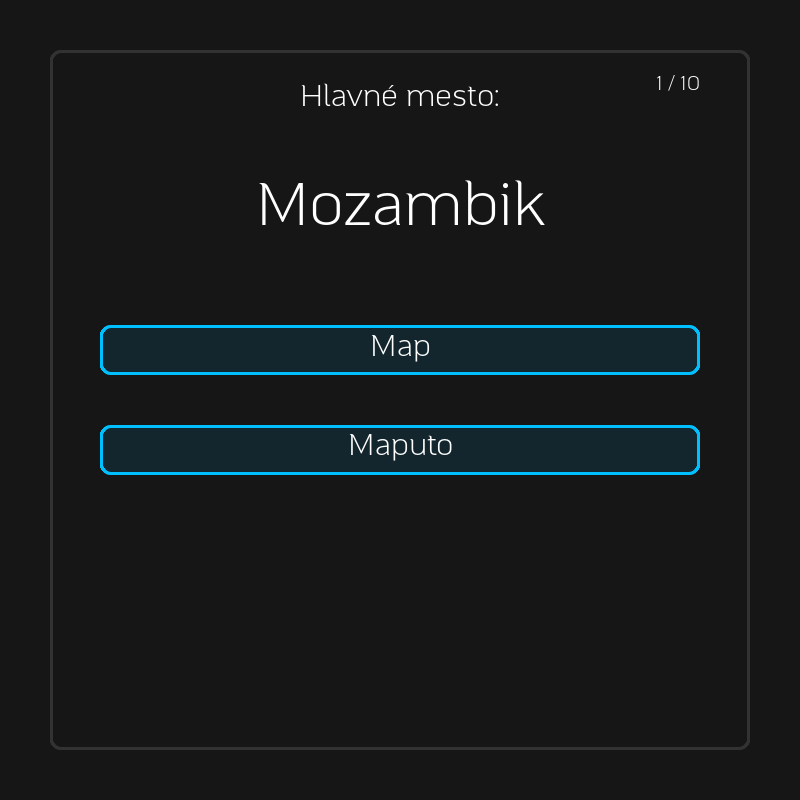

# Geografia – Quiz

A Slovak capital-city quiz built with Pygame. Type an answer or choose an
autocomplete suggestion, then see your score at the end of the round.



## Run

Requires Python 3.10+.

```sh
python3 -m venv .venv
source .venv/bin/activate
python -m pip install -r requirements.txt
python main.py
```

On Windows, activate with `.venv\Scripts\activate`.

Click **Hrať** and type a capital. **Enter** submits the text directly; clicking
a suggestion also submits it. Answers ignore accents, case, spaces, and punctuation.
**Backspace** deletes text; **Ctrl+Backspace** clears the field. **Escape** returns
to the menu, or quits from the menu.

In **Nastavenia**, click the region and question-count buttons to cycle through
the options. Rounds contain unique countries; small regions use the available
countries. Results stay visible until you start again or return to the menu.

## Implementation

Scoring and question selection live in `quiz.py`. Each question accepts one answer;
input stays locked through feedback and fading. Suggestions are indexed once per
round and refreshed when the text changes. Rounded controls, text, and the panel
are cached while preserving the original dark background, cyan borders, and font.

A local menu-render benchmark fell from about 1.06 ms to 0.10 ms per frame,
excluding display updates and the frame cap.

The bundled questions use Slovak country and capital names from
`data/countries_svk.txt`, grouped by region. Kazakhstan's entry now uses Astana,
matching the [official country information](https://www.gov.kz/article/19305?lang=en).

## Checks

```sh
python -m unittest discover -s tests -v
python tools/benchmark.py
python tools/preview.py
```

These commands run headlessly. Tests cover complete rounds, replay, duplicate
submissions, text input, suggestions, region filtering, and transitions.
The preview script saves actual menu, quiz, and results screens to `docs/`.
